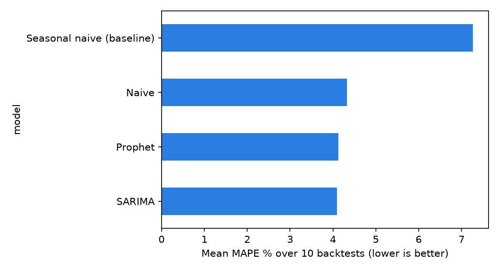
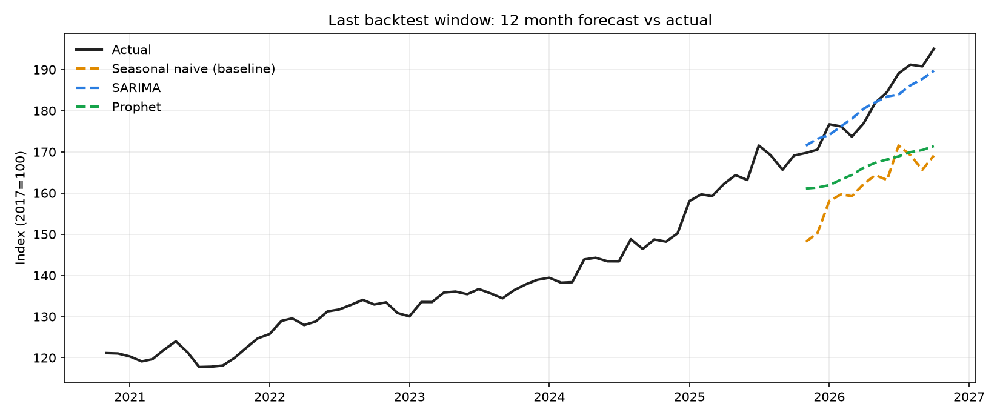
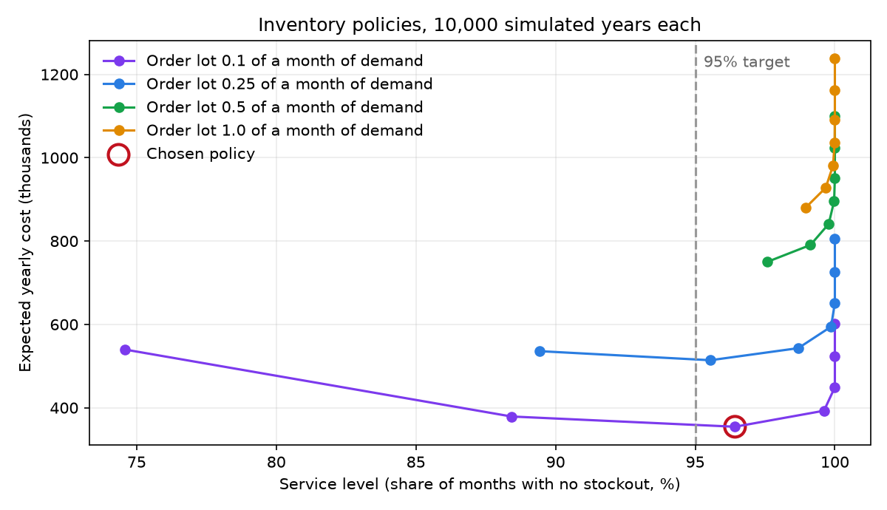

# Semiconductor Demand Forecast

Forecasts monthly US semiconductor output 12 months ahead with **SARIMA** and **Prophet**, and tests whether they beat simple baselines using a rolling origin backtest.

## Data
FRED series [IPG3344S](https://fred.stlouisfed.org/series/IPG3344S), Industrial Production: Semiconductors and Other Electronic Components (index, 2017 = 100, monthly), 2000 to 2026. It measures production volume, not dollar sales, so it is a public proxy for semiconductor demand.

## Method
- 10 backtests. At each origin a model sees only past data and forecasts the next 12 months. Origins step forward one year, so no future data leaks into training.
- Baselines: **Naive** (repeat last month) and **Seasonal naive** (repeat the same month last year).
- Models: **SARIMA** (log scale, order picked by AIC at every origin) and **Prophet** (log scale, yearly seasonality).
- Metrics: MAE, RMSE, MAPE, and MASE (scaled against seasonal naive in training).

## Results (mean over 10 backtests, lower is better)

| Model | MAPE % | MAE | MASE | MAPE vs Naive | Folds beating Naive |
|---|---|---|---|---|---|
| SARIMA | 4.10 | 5.00 | 0.80 | 5.4% better | 5 of 10 |
| Prophet | 4.13 | 5.61 | 0.87 | 4.6% better | 6 of 10 |
| Naive | 4.33 | 5.98 | 0.94 | n/a | n/a |
| Seasonal naive | 7.26 | 9.72 | 1.53 | 67.8% worse | 2 of 10 |




## What this says
- SARIMA and Prophet beat seasonal naive by about 43%, but that baseline is weak here because the series is trend driven with little seasonality.
- Against the stronger Naive baseline the gain is only about 5%, and neither model wins in most folds. This series is hard to beat with a simple model, and the honest takeaway is that the extra complexity buys a small improvement.
- In the last window SARIMA tracked the 2026 upswing closely, while Prophet underestimated the trend.

## Inventory simulation (Monte Carlo)

What does a forecast do for a supply chain? `simulate_inventory.py` uses the SARIMA forecast for the next 12 months and the real spread of its backtest errors to simulate a reorder point and order quantity policy under uncertain demand, 10,000 simulated years per policy.

How it works (code in `inventory.py`):
- Monthly demand is the SARIMA forecast times a random error. The errors are resampled from the 120 log errors SARIMA made across the 10 backtests (spread 0.046, mean error minus 0.032), so the uncertainty comes from real forecast misses.
- Policy: at the end of each month, if stock on hand is at or below the reorder point, order whole lots of size Q to lift it back above that point. Orders arrive one month later. Unmet demand is lost.
- Reorder point = next month's forecast times (1 plus z times the error spread). A bigger z means more safety stock. Q is set as a share of one month of average demand.
- Costs: holding 1 per unit per month, 10,000 per order, 19 per lost unit. Service level is the share of months with no stockout.

Results for the policies that matter (all 21 combinations tested are in `results/inventory_simulation.csv`):

| z | Order lot (months of demand) | Service level | Fill rate | Holding cost | Ordering cost | Lost sales cost | Total yearly cost | |
|---|---|---|---|---|---|---|---|---|
| minus 0.50 | 0.1 | 88.4% | 99.79% | 162,494 | 120,000 | 96,415 | 378,909 | |
| 0.00 | 0.1 | 96.4% | 99.96% | 215,028 | 120,000 | 19,327 | 354,356 | chosen |
| 0.00 | 0.25 | 98.7% | 99.98% | 415,967 | 120,000 | 7,018 | 542,985 | |
| 0.00 | 1.0 | 99.9% | 100.00% | 870,638 | 109,964 | 312 | 980,914 | |
| 0.50 | 0.1 | 99.6% | 100.00% | 271,650 | 120,000 | 1,125 | 392,775 | |
| 1.65 | 0.1 | 100.0% | 100.00% | 403,483 | 120,000 | 0 | 523,483 | |



**Chosen policy:** the cheapest one that keeps the service level at 95% or higher is z of 0 with small lots of 0.1 months of demand: 96.4% service level, total cost about 354,000 a year (5th to 95th percentile 290,000 to 435,000). Dropping safety stock below that breaks service quickly (88% at z of minus 0.5). Adding more safety stock only adds holding cost.

**What it says:** because SARIMA's error is small (about 5% a month), safety stock matters little here. Most of the cost is cycle stock, which is set by how big the order lots are, so ordering small and often wins. A noisier forecast would need a larger z, and that is where forecast accuracy turns into money.

**Limits of the simulation:**
- The data is a production index, not real orders. One index point is treated as 1,000 units a month, which is an assumption, so compare policies with each other and do not read the absolute costs as real money.
- The cost figures (holding, ordering, lost sale) are illustrative choices, not measured from a company.
- The first grid I tried used lots of one month or more and gave about 100% service for every policy, so nothing was being traded off. I changed the grid to smaller lots and added negative z values so the tradeoff is visible. The grid was set before looking at which policy came out cheapest.
- Backtest errors have a mean of minus 0.032 (the forecast was a little high on average), which lowers stockouts. In the most recent window the forecast was too low, so real service could be worse than simulated.
- Demand months are treated as independent draws, and the lead time is fixed at one month.

Run it: `.venv/bin/python simulate_inventory.py` (needs `results/backtest_forecasts.csv`, which `forecast.py` writes), and the tests with `.venv/bin/python -m pytest`.

## Limits
Industrial production is not revenue, the backtest has 10 origins (a small sample), and no external drivers such as capex or memory prices are used. Adding them is the obvious next step.

## Run
```
python3.12 -m venv .venv && .venv/bin/pip install -r requirements.txt
.venv/bin/python forecast.py
```
The script downloads the data from FRED (no key needed) and writes `results/`.
